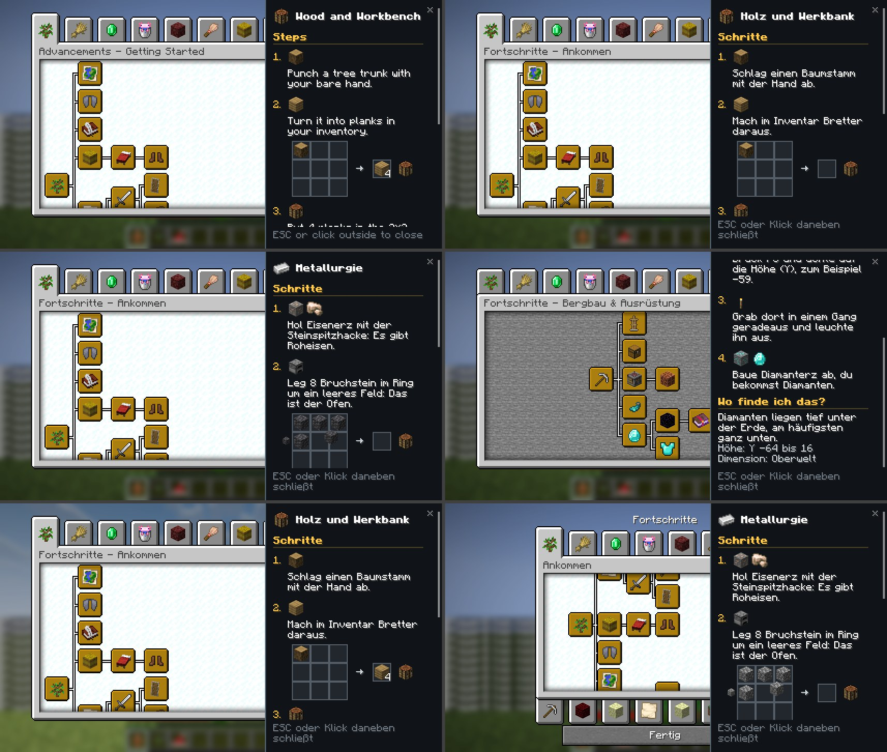

# Quest-Details

Fabric-Client-Mod für **Minecraft 26.3**. Ein Klick auf eine Quest im Questbuch öffnet rechts eine **Seitenleiste** mit:

- nummerierten Schritten und echten Item-Symbolen aus dem Spiel
- einem **animierten Rezept-Raster** (Werkbank, Ofen, Schmelzofen, Räucherofen, Lagerfeuer, Steinsäge, Schmiedetisch), in das die Zutaten nacheinander hineingleiten. Das Rezept stammt aus den Spieldaten.
- „Wo finde ich das?“ mit Biomen, Höhe und Dimension

Der Quest-Baum bleibt links sichtbar. Eine andere Quest anklicken wechselt den Inhalt, **ESC** oder ein Klick daneben schließt die Leiste. Die Animation ist dezent: Sie läuft in Schleife, ohne Ton und ohne Blinken.



Gemacht für das Questbuch des Minecraft-Weihnachtsprojekts 2026: ein Datapack mit Fortschritten im Namespace `leitfaden`. Nur Quests aus diesem Namespace öffnen die Leiste, alle anderen Fortschritts-Tabs bleiben unverändert.

## Questbuch-Daten

Pro Quest liegt eine Datei im Resourcepack, der Pfad entspricht der Fortschritts-ID:

```
Fortschritt  leitfaden:ankommen/werkbank
Datei        assets/leitfaden/questbuch/ankommen/werkbank.json
```

```json
{
  "schritte": [
    { "text": { "translate": "questbuch.ankommen.werkbank.schritt.1", "fallback": "Punch a tree" }, "items": ["#minecraft:logs"] },
    { "text": { "translate": "questbuch.ankommen.werkbank.schritt.2", "fallback": "Craft a crafting table" },
      "items": ["minecraft:crafting_table"], "rezept": "minecraft:crafting_table" }
  ],
  "fundort": [
    { "biome": ["minecraft:forest", "#minecraft:is_taiga"], "hoehe": { "von": 60, "bis": 120 }, "dimension": "minecraft:overworld" }
  ]
}
```

Alle Felder sind in [docs/DATENFORMAT.md](docs/DATENFORMAT.md) beschrieben. Fehlt die Datei, zeigt die Leiste die Beschreibung der Quest. Fehlerhafte Einträge werden einzeln übersprungen und im Log gemeldet.

## Kompatibilität

- **Better Advancements** (getestet mit 0.6.0.81) wird unterstützt. Fehlt die Mod, funktioniert die Leiste auf dem normalen Fortschrittsbildschirm.
- Die Anbindung an Better Advancements ist ein einziger Mixin auf dessen öffentliche Methode `BetterAdvancementWidget.drawHover`. Ändert sich die Methode in einer späteren Version, startet das Spiel trotzdem, nur öffnet sich dann die Leiste dort nicht.
- Getestet mit Sodium 0.9.2 und Iris 1.11.7, mit und ohne Complementary-Reimagined-Shader.
- Benötigt Fabric API. Läuft nur im Client, auch im Mehrspieler. Rezepte liest die Mod aus den Spieldaten im Jar, sie müssen im Rezeptbuch nicht freigeschaltet sein.
- Sprachen: Deutsch und Englisch.

## Entwickeln

Benötigt JDK 25. Der Test-Client lädt das Questbuch (Datapack und Resourcepack) aus dem Nachbar-Repo `../mc-weihnachten-2026`.

```
./gradlew test                                        # Datenformat, Rezepte aus dem Minecraft-Jar, Animation
./gradlew build                                       # Jar in build/libs/
./gradlew runClientGameTest                           # Test-Client mit Better Advancements, Sodium und Iris
./gradlew runClientGameTest -PohneBetterAdvancements  # dasselbe auf dem Vanilla-Bildschirm
```

Der Test-Client sucht mit der Maus eine Quest und klickt sie an. Danach prüft er Inhaltswechsel, Klick daneben und ESC und macht Screenshots auf Englisch und Deutsch, mit und ohne Shader (`build/quest-details-screenshots/`). Außerdem liest er alle Questbuch-Dateien und schreibt Probleme in `datencheck.txt`, etwa unbekannte Items oder Rezepte ohne Raster. Den Shader einmal herunterladen, siehe `testumgebung/LIESMICH.md`.

## Lizenz

MIT
